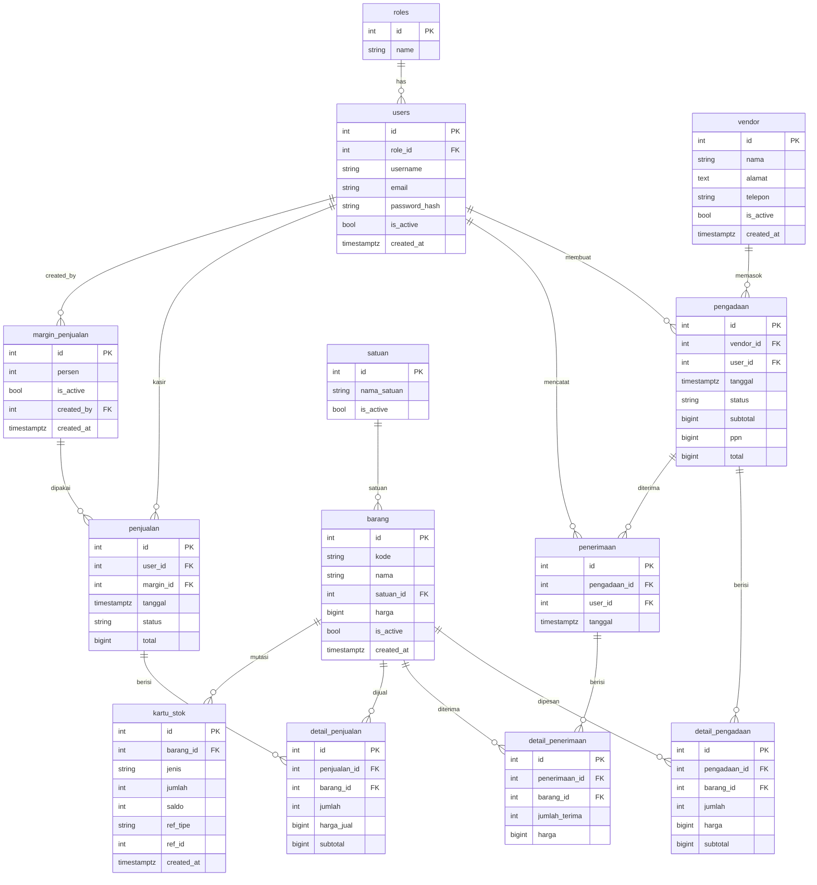

# Stokku

Sistem Informasi Pengadaan, Penerimaan, dan Penjualan Barang dengan Kartu Stok.

Repositori: https://github.com/putriamdw/Stokku

## Deskripsi

Stokku membantu pemilik usaha mencatat pengadaan barang ke vendor, penerimaan barang secara bertahap, penjualan barang, dan mutasi stok dalam satu alur yang saling terhubung. Pengadaan menyimpan harga beli pada saat pesanan dibuat, penerimaan menambah saldo melalui kartu stok, dan penjualan mengurangi saldo setelah finalisasi. Harga jual dihitung dari harga barang ditambah persentase margin yang aktif.

Stokku dirancang sebagai backend REST API (Go). Data master dikelola lebih dahulu, lalu transaksi dibangun di atas data tersebut. Pendekatan ini membuat aturan bisnis dapat diuji secara terpisah dan memudahkan pengembangan antarmuka di masa depan tanpa mengubah kontrak inti. Proyek ini adalah boilerplate tugas kelompok: rancangan sistem lengkap, dengan fitur Satuan dan Barang yang sudah berjalan utuh.

## Role dan Hak Akses

| Role | Hak Akses Utama | Batasan |
|---|---|---|
| Admin | Mengelola role, user, satuan, barang, vendor, dan margin, melihat seluruh transaksi. | Tidak boleh menghapus role admin atau role yang masih dipakai user. |
| Gudang | Membuat pengadaan, mencatat penerimaan, melihat barang, vendor, dan kartu stok. | Tidak mengelola user, role, margin, dan penjualan. |
| Kasir | Membuat penjualan, menambah detail, finalisasi, melihat barang, margin aktif, dan kartu stok. | Tidak mengubah data master dan pengadaan. |

Pada boilerplate ini role baru merupakan rancangan. Tabel `roles` sudah dibuat dan tiga role awal sudah di-seed melalui migrasi, tetapi middleware autentikasi dan otorisasi belum diimplementasikan. Karena itu, seluruh endpoint yang tersedia saat ini dapat diakses tanpa token.

## Fitur

| No | Fitur | Role | Status pada boilerplate |
|---|---|---|---|
| 1 | Login dan profil pengguna | Semua | Rancangan |
| 2 | Kelola data master: role, user, satuan, barang, vendor, margin | Admin | Sebagian: satuan dan barang |
| 3 | Pengadaan barang ke vendor dengan PPN 10% | Admin, Gudang | Rancangan |
| 4 | Penerimaan barang bertahap dengan validasi sisa | Admin, Gudang | Rancangan |
| 5 | Penjualan draft dan finalisasi dengan stored procedure | Admin, Kasir | Rancangan |
| 6 | Kartu stok dan riwayat mutasi | Semua | Rancangan |
| 7 | Dashboard ringkasan aktivitas | Semua | Rancangan |

### Alur Bisnis

1. **Barang masuk:** buat pengadaan (status `diproses`), tambah detail (harga diambil dari barang, lalu subtotal, PPN 10 persen, dan total dihitung ulang), lakukan penerimaan bertahap (tiap item tidak boleh melebihi sisa), kartu stok `masuk` bertambah, dan bila semua sisa 0 status pengadaan menjadi `selesai`.
2. **Barang keluar:** buat penjualan `draft` dengan margin aktif, tambah detail (cek stok, `harga_jual = harga + harga x persen / 100` dengan bilangan bulat), lalu finalisasi lewat stored procedure `sp_finalisasi_penjualan` yang menulis kartu stok `keluar` dan mengubah status menjadi `final`.
3. **Kartu stok:** menyimpan saldo setelah setiap mutasi. Saldo terakhir barang diambil dari view `v_stok_barang`.

### Aturan Bisnis

| No | Aturan | Status |
|---|---|---|
| 1 | Jumlah, harga, dan persen tidak boleh negatif, jumlah item harus lebih dari nol. | Sebagian: validasi barang dan satuan |
| 2 | Barang, vendor, dan satuan non-aktif tidak boleh dipakai pada transaksi baru. | Sebagian: referensi satuan dicek |
| 3 | Penerimaan ditolak jika jumlah terima melebihi sisa atau pengadaan sudah selesai. | Rancangan |
| 4 | Saldo kartu stok tidak boleh negatif, baris barang dikunci saat mutasi. | Rancangan |
| 5 | Finalisasi hanya untuk penjualan draft dan hanya oleh pembuat atau admin. | Rancangan |
| 6 | Satuan tidak boleh dinonaktifkan jika masih dipakai barang aktif. | Terimplementasi |
| 7 | Password minimal 8 karakter dan hash tidak pernah muncul di response. | Rancangan |
| 8 | Semua uang menggunakan int64 rupiah tanpa pecahan. | Terimplementasi pada model dan migrasi |

## Rancangan Database

Rancangan database menggunakan tiga belas tabel, satu view, dan satu stored procedure. Seluruh nilai uang disimpan sebagai `BIGINT` rupiah tanpa desimal. Skema lengkap ada di `migrations/001_init.sql`.

| No | Tabel | Fungsi | Kolom Utama dan Relasi |
|---|---|---|---|
| 1 | roles | Daftar role. | id, name. Satu role dipakai banyak user. |
| 2 | users | Akun pengguna. | id, role_id, username, email, password_hash, is_active. FK ke roles. |
| 3 | satuan | Satuan barang. | id, nama_satuan, is_active. Dipakai barang. |
| 4 | barang | Data master barang. | id, kode, nama, satuan_id, harga, is_active. FK ke satuan. |
| 5 | vendor | Pemasok barang. | id, nama, alamat, telepon, is_active. |
| 6 | margin_penjualan | Persentase margin. | id, persen, is_active, created_by. Hanya satu baris aktif. |
| 7 | pengadaan | Header pesanan. | id, vendor_id, user_id, status, subtotal, ppn, total. |
| 8 | detail_pengadaan | Rincian pesanan. | id, pengadaan_id, barang_id, jumlah, harga, subtotal. |
| 9 | penerimaan | Header penerimaan. | id, pengadaan_id, user_id, tanggal. |
| 10 | detail_penerimaan | Rincian barang diterima. | id, penerimaan_id, barang_id, jumlah_terima, harga. |
| 11 | penjualan | Header penjualan. | id, user_id, margin_id, status, total. |
| 12 | detail_penjualan | Rincian barang dijual. | id, penjualan_id, barang_id, jumlah, harga_jual, subtotal. |
| 13 | kartu_stok | Mutasi stok masuk dan keluar. | id, barang_id, jenis, jumlah, saldo, ref_tipe, ref_id. |




Catatan:

1. Harga pada `detail_pengadaan` adalah snapshot harga barang saat pesanan dibuat, sehingga perubahan harga master tidak mengubah nilai pesanan lama.
2. Hanya satu margin yang boleh aktif. Aturan ini dibuat dengan partial unique index pada kolom `is_active`.
3. Saldo pada `kartu_stok` adalah saldo setelah mutasi. Saldo terakhir sebuah barang diambil dari baris dengan id terbesar melalui view `v_stok_barang`.
4. Stored procedure `sp_finalisasi_penjualan` mengunci baris penjualan dan barang, memeriksa stok, lalu menulis kartu stok keluar dalam satu transaksi.
5. Penghapusan data master memakai soft delete `is_active`, bukan DELETE fisik, agar riwayat transaksi tetap utuh.
6. `kartu_stok` memakai referensi polimorfik `ref_tipe` dan `ref_id` ke penerimaan atau penjualan, sengaja tanpa foreign key.

## Arsitektur

Struktur proyek meliputi route, middleware, service, repository, model, helper, config, dan database, mengikuti Clean Architecture pada modul praktikum. Arah dependensi satu arah: route memanggil service, service memanggil repository, dan repository berbicara ke PostgreSQL. Model dipakai bersama sebagai bentuk data, sedangkan helper menyediakan fungsi response dan pembacaan request.
| Layer | Boleh mengimpor (proyek) | Larangan utama |
|---|---|---|
| app/model | Tidak ada | Query, logika bisnis, Fiber. |
| app/repository | app/model | Fiber, status HTTP, aturan bisnis. |
| app/service | app/model, app/repository, helper | SQL dan pgx, Fiber hanya untuk membaca request. |
| helper | app/model | Business logic dan query. |
| middleware | helper | Validasi bisnis dan query. |
| route | app/service, middleware, helper | If validasi dan logika bisnis. |
| config | app/service, route, middleware, helper | Logika bisnis. |
| database | config | Aturan bisnis. |

Struktur folder:

```text
Stokku/
|-- app/
|   |-- model/
|   |   |-- response.go
|   |   |-- satuan.go
|   |   `-- barang.go
|   |-- repository/
|   |   |-- errors.go
|   |   |-- satuan_repository.go
|   |   `-- barang_repository.go
|   `-- service/
|       |-- errors.go
|       |-- common_rules.go
|       |-- common_rules_test.go
|       |-- satuan_rules.go
|       |-- satuan_rules_test.go
|       |-- satuan_service.go
|       |-- barang_rules.go
|       |-- barang_rules_test.go
|       |-- barang_service.go
|       `-- services.go
|-- config/
|   |-- app.go
|   |-- env.go
|   `-- logger.go
|-- database/
|   `-- postgres.go
|-- docs/
|   |-- API.md
|   `-- erd.png
|-- helper/
|   |-- request.go
|   `-- response.go
|-- middleware/
|   `-- middleware.go
|-- migrations/
|   `-- 001_init.sql
|-- route/
|   `-- route.go
|-- main.go
|-- go.mod
|-- .env.example
`-- README.md
```

## Fitur yang Berjalan Utuh

Boilerplate memiliki tiga kelompok endpoint yang berjalan: health, satuan, dan barang (total sebelas endpoint). Seluruh endpoint memakai prefix `/api/v1`.

| No | Method | Path | Fungsi Service | Status Sukses |
|---|---|---|---|---|
| 1 | GET | /api/v1/health | healthCheck | 200 |
| 2 | GET | /api/v1/satuan | Satuan.List | 200 |
| 3 | GET | /api/v1/satuan/:id | Satuan.Get | 200 |
| 4 | POST | /api/v1/satuan | Satuan.Create | 201 |
| 5 | PUT | /api/v1/satuan/:id | Satuan.Replace | 200 |
| 6 | DELETE | /api/v1/satuan/:id | Satuan.Delete | 204 |
| 7 | GET | /api/v1/barang | Barang.List | 200 |
| 8 | GET | /api/v1/barang/:id | Barang.Get | 200 |
| 9 | POST | /api/v1/barang | Barang.Create | 201 |
| 10 | PUT | /api/v1/barang/:id | Barang.Replace | 200 |
| 11 | DELETE | /api/v1/barang/:id | Barang.Delete | 204 |

Request dengan body wajib memakai `Content-Type: application/json`. Body satuan berisi `nama_satuan`. Body barang berisi `kode`, `nama`, `satuan_id`, dan `harga` (int64, tidak boleh negatif). Daftar mendukung query `page`, `limit` (1 sampai 100), `search`, `sort`, `order`, dan `is_active`. Kode barang yang sudah dipakai menghasilkan 409 Conflict. Kontrak lengkap, termasuk endpoint rancangan, ada di [docs/API.md](docs/API.md).

### Format Response dan Status

```json
{
  "success": true,
  "message": "ok",
  "data": {},
  "meta": { "page": 1, "limit": 10, "total": 0, "total_pages": 0 }
}
```

```json
{
  "success": false,
  "message": "validasi gagal",
  "errors": { "nama_satuan": "wajib diisi" }
}
```

| Status | Makna |
|---|---|
| 200 | Sukses membaca atau mengubah. |
| 201 | Data baru dibuat, header Location disertakan. |
| 204 | Data berhasil dinonaktifkan, tanpa body. |
| 400 | JSON rusak atau id bukan angka positif. |
| 404 | Data atau endpoint tidak ditemukan. |
| 409 | Duplikat nilai unik. |
| 415 | Content-Type bukan application/json. |
| 422 | Validasi field atau aturan bisnis gagal. |
| 500 | Kesalahan server, detail hanya di log. |

## Teknologi

Go, Fiber v2, PostgreSQL dengan pgx/v5 (pgxpool), godotenv, `log/slog` (JSON) dengan lumberjack untuk rotasi log. Middleware: request id, recover, helmet, CORS, dan request logger.

## Cara Menjalankan

Prasyarat: Go (sesuai versi pada `go.mod`) dan PostgreSQL.

```bash
git clone https://github.com/putriamdw/Stokku.git
cd Stokku
cp .env.example .env
createdb stokku
psql "$DATABASE_URL" -f migrations/001_init.sql
go mod tidy
go run .
```

Isi `.env` dari `.env.example`, minimal `DATABASE_URL`. Server berjalan di `http://localhost:3000`. Cek dengan `GET /api/v1/health`.

| Variabel | Keterangan |
|---|---|
| DATABASE_URL | Wajib, koneksi PostgreSQL. |
| APP_NAME, APP_PORT | Nama aplikasi dan port (bawaan 3000). |
| LOG_LEVEL | Opsional, bawaan `info`. |
| JWT_SECRET, JWT_EXPIRE_HOURS, ADMIN_* | Disiapkan untuk autentikasi, belum dipakai. |

Berkas `.env` asli tidak boleh di-commit. Log ditulis ke stdout dan `logs/app.log`. Saat menerima SIGINT atau SIGTERM, server memberi waktu sepuluh detik agar request yang berjalan selesai sebelum ditutup.

## Pengujian

```bash
go build ./...
go vet ./...
go test ./...
```

Unit test mencakup aturan validasi satuan dan barang serta penghitungan total halaman. Hasil pengujian otomatis dan delapan belas skenario pengujian manual API dimuat pada laporan (Bab IV).

## Anggota dan Peran

| No | Nama | NIM | Peran | Fokus Pekerjaan |
|---|---|---|---|---|
| 1 | Putri Atika Mahardika D | 434241080 | Git Master | Commit awal, migrasi, database, model, repository, review dan merge. |
| 2 | Diaul Haq | 434241074 | Anggota | Config, helper, middleware, service, rules dan test, route, dokumentasi. |

## Alur Kerja Git

Setiap anggota bekerja di branch sendiri dengan micro commit (Conventional Commits), lalu membuat pull request ke `main`. Hanya Git Master yang melakukan merge, dengan opsi Create a merge commit agar commit setiap anggota tetap terlihat. Pembagian branch dan commit lengkap ada pada laporan (Bab V).

## Batasan Saat Ini

Autentikasi JWT, otorisasi berbasis role, dan fitur transaksi (pengadaan, penerimaan, penjualan, kartu stok, dashboard) masih berupa rancangan dan akan dilengkapi pada pengembangan berikutnya.